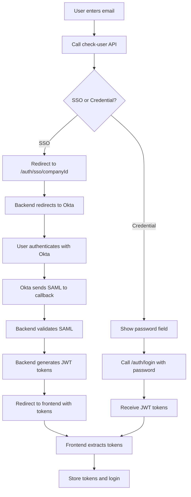

# Multi-Company Okta SSO Implementation

This directory contains the implementation for multi-company Okta SSO support in the TRL backend application.

## 📖 Documentation

We have created three comprehensive guides for different audiences:

### 1. [SSO_IMPLEMENTATION_SUMMARY.md](./SSO_IMPLEMENTATION_SUMMARY.md) - **START HERE**
Quick overview and decision guide. Read this first to understand:
- What changed
- Quick start instructions
- Links to detailed guides
- Implementation checklist

### 2. [SSO_SETUP_GUIDE.md](./SSO_SETUP_GUIDE.md) - **For Backend Admins**
Complete backend and database setup instructions:
- SSO config structure and payload
- Database setup with SQL examples
- Okta dashboard configuration
- Testing procedures
- Troubleshooting guide

### 3. [SSO_CLIENT_INTEGRATION_GUIDE.md](./SSO_CLIENT_INTEGRATION_GUIDE.md) - **For Frontend Developers**
Complete frontend implementation guide:
- React Native implementation (mobile)
- Flutter implementation (mobile)
- React implementation (web)
- Full working code examples
- Error handling strategies
- Testing procedures

---

## 🎯 Who Should Read What?

| Role | Read This | Purpose |
|------|-----------|---------|
| **Project Manager / Tech Lead** | [Summary](./SSO_IMPLEMENTATION_SUMMARY.md) | Understand changes and coordinate teams |
| **Backend Developer / DevOps** | [Setup Guide](./SSO_SETUP_GUIDE.md) | Configure database and Okta |
| **Mobile App Developer** | [Client Guide](./SSO_CLIENT_INTEGRATION_GUIDE.md) | Implement SSO in mobile apps |
| **Web App Developer** | [Client Guide](./SSO_CLIENT_INTEGRATION_GUIDE.md) | Implement SSO in web apps |
| **QA / Tester** | All three guides | Understand flow and test scenarios |

---

## 🚀 Quick Start by Role

### Backend Admin / DevOps
1. Read [SSO_SETUP_GUIDE.md](./SSO_SETUP_GUIDE.md)
2. Get company ID from database
3. Update company's `sso_config` field
4. Configure Okta dashboard
5. Test SSO login

### Mobile Developer
1. Read [SSO_CLIENT_INTEGRATION_GUIDE.md](./SSO_CLIENT_INTEGRATION_GUIDE.md) - Mobile App section
2. Install in-app browser library
3. Implement email check flow
4. Add SSO redirect logic
5. Handle callback and extract tokens
6. Test with SSO-enabled company

### Web Developer
1. Read [SSO_CLIENT_INTEGRATION_GUIDE.md](./SSO_CLIENT_INTEGRATION_GUIDE.md) - Web App section
2. Update login component
3. Implement email check flow
4. Add SSO redirect logic
5. Handle callback route and extract tokens
6. Test with SSO-enabled company

---

## 📋 Implementation Overview

### What Changed?

**Before:**
- Single SSO configuration using environment variables
- Routes: `/auth/okta` and `/auth/okta/callback`
- All companies shared one Okta instance

**After:**
- Multiple companies, each with their own Okta configuration
- SSO config stored per-company in database (`companies.sso_config`)
- Routes: `/auth/sso/:companyId` and `/auth/sso/callback/:companyId`
- Each company has unique SSO URLs with their company ID

### Key Features

✅ **Multi-Company Support** - Each company can have its own Okta instance
✅ **Dynamic Configuration** - SSO config stored in database, no code changes needed
✅ **Backward Compatible** - Credential-based login still works
✅ **Flexible** - Easy to add new SSO-enabled companies
✅ **Secure** - Company isolation, SAML validation, JWT tokens

---

## 🔄 Authentication Flow



---

## 📦 Files in This Implementation

### Source Code
- `src/auth/dynamic-saml.strategy.ts` - Dynamic multi-company SAML strategy
- `src/auth/auth.controller.ts` - Updated with `/auth/sso/:companyId` routes
- `src/auth/auth.service.ts` - Enhanced `checkUser()` method
- `src/auth/auth.module.ts` - Updated providers
- `src/companies/company.interface.ts` - Added `SsoConfig` interface
- `src/companies/company.service.ts` - Type fixes for SSO config

### Documentation
- `README_SSO.md` - This file (overview)
- `SSO_IMPLEMENTATION_SUMMARY.md` - Quick summary and checklist
- `SSO_SETUP_GUIDE.md` - Backend setup instructions
- `SSO_CLIENT_INTEGRATION_GUIDE.md` - Frontend implementation guide

### Configuration
- `.env.example` - Updated with deprecated SAML variables note

### Removed
- `src/auth/okta.strategy.ts` - Old single-company strategy (deleted)

---

## 🎓 Example Scenarios

### Scenario 1: Sarepta Company (SSO-Enabled)

**Database:**
```sql
companies.id = 'company_01JQHXYZ...'
companies.name = 'Sarepta'
companies.login_type = 'sso'
companies.sso_config = {
  "saml_entry_point": "https://sarepta.okta.com/app/.../sso/saml",
  "saml_issuer": "http://www.okta.com/exk...",
  ...
}
```

**User Flow:**
1. User enters: `john@sarepta.com`
2. API returns: `{ is_sso_login: true, company_id: "company_01JQHXYZ...", ... }`
3. App redirects to: `/api/v1/auth/sso/company_01JQHXYZ...`
4. User logs in via Okta
5. Receives JWT tokens

### Scenario 2: Generic Company (Credential-Based)

**Database:**
```sql
companies.id = 'company_02ABCDEF...'
companies.name = 'Generic Corp'
companies.login_type = 'credentials'
companies.sso_config = null
```

**User Flow:**
1. User enters: `jane@generic.com`
2. API returns: `{ is_sso_login: false }`
3. App shows password field
4. User enters password
5. API call to `/auth/login`
6. Receives JWT tokens

---

## ✅ Testing

### Quick Test - Check User API
```bash
curl -X POST http://localhost/api/v1/auth/check-user \
  -H "Content-Type: application/json" \
  -d '{"email": "user@sarepta.com"}'
```

**Expected Response (SSO):**
```json
{
  "is_sso_login": true,
  "company_id": "company_01JQHXYZ123456789ABCDEFG",
  "sso_entry_url": "/api/v1/auth/sso/company_01JQHXYZ123456789ABCDEFG"
}
```

### Quick Test - Database Query
```sql
-- Check SSO configuration
SELECT
  id,
  name,
  login_type,
  sso_config->'saml_entry_point' as entry_point,
  sso_config->'saml_issuer' as issuer
FROM companies
WHERE login_type = 'sso';
```

---

## 🐛 Common Issues

| Issue | Guide | Section |
|-------|-------|---------|
| How to set up SSO config? | [Setup Guide](./SSO_SETUP_GUIDE.md) | Manual Setup Instructions |
| How to implement in React Native? | [Client Guide](./SSO_CLIENT_INTEGRATION_GUIDE.md) | React Native Implementation |
| How to implement in Flutter? | [Client Guide](./SSO_CLIENT_INTEGRATION_GUIDE.md) | Flutter Implementation |
| How to implement in React web? | [Client Guide](./SSO_CLIENT_INTEGRATION_GUIDE.md) | React Implementation |
| SSO redirect not working? | [Setup Guide](./SSO_SETUP_GUIDE.md) | Troubleshooting |
| SAML validation failing? | [Setup Guide](./SSO_SETUP_GUIDE.md) | Troubleshooting |
| Tokens not appearing? | [Client Guide](./SSO_CLIENT_INTEGRATION_GUIDE.md) | Troubleshooting |

---

## 📞 Need Help?

1. **Read the appropriate guide** for your role (see "Who Should Read What?" above)
2. **Check troubleshooting sections** in the guides
3. **Review common issues** table above
4. **Test with provided examples** in the guides
5. **Contact the development team** if issues persist

---

## 🔐 Security Notes

- All SSO flows use HTTPS in production
- SAML assertions are validated on the backend
- JWT tokens are signed with HS384 algorithm
- Company isolation is enforced (users can only auth through their company)
- Certificates are stored securely in database (ensure backups are encrypted)

---

## 📝 Next Steps

### For Backend Team
1. ✅ Code implementation complete
2. ⏳ Update database with SSO configs for each company
3. ⏳ Configure Okta dashboards
4. ⏳ Test SSO flows
5. ⏳ Deploy to staging
6. ⏳ Deploy to production

### For Frontend Team
1. ⏳ Read [Client Integration Guide](./SSO_CLIENT_INTEGRATION_GUIDE.md)
2. ⏳ Implement check-user flow
3. ⏳ Add SSO redirect logic
4. ⏳ Handle callback URLs
5. ⏳ Test with SSO-enabled companies
6. ⏳ Deploy to staging
7. ⏳ Deploy to production

---

## 📚 Additional Resources

- [SAML 2.0 Technical Overview](http://docs.oasis-open.org/security/saml/Post2.0/sstc-saml-tech-overview-2.0.html)
- [Okta SAML Concept](https://developer.okta.com/docs/concepts/saml/)
- [JWT Best Practices](https://tools.ietf.org/html/rfc8725)
- [NestJS Passport Documentation](https://docs.nestjs.com/security/authentication)

---

**Last Updated:** 2025-01-21
**Version:** 1.0.0
**Status:** Backend Implementation Complete ✅
